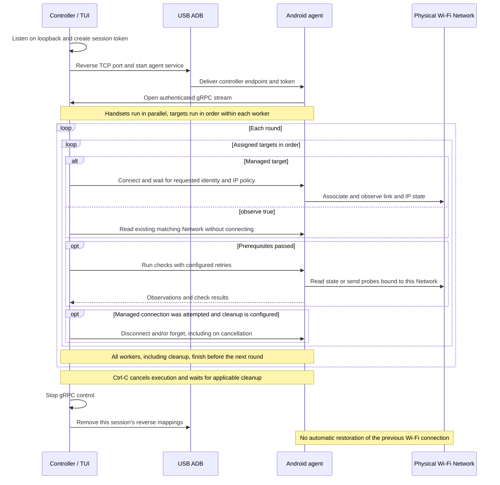

# Dropcheck Agent

[](https://github.com/mi2428/dropcheck-agent/actions/workflows/controller.yml)
[](https://github.com/mi2428/dropcheck-agent/actions/workflows/android.yml)
[](https://github.com/mi2428/dropcheck-agent/actions/workflows/release.yml)

ADB-controlled Android probes for automated Wi-Fi and access-network end-to-end tests.
Born at ShowNet in 2026, built for every event NOC.

Inspect Wi-Fi from the handset's perspective: connection and IP state, cached scans, security, Wi-Fi 6/6E/7 and EHT/MLO evidence, and offline IEEE vendor lookup.
Run ping, traceroute, path-MTU discovery, DNS, HTTP, download, and external-IP probes through the selected physical Wi-Fi Network.
Use Controller Shell for field work, YAML-driven TUI checks for repeated testing, the Go API for integration, or the Android app's Shell, log viewer, and widgets on the handset.



## Build

From the repository root, build the APK and controller with the same version:

```console
$ make build VERSION=0.0.0-dev
+ ./gradlew :agent:assembleDebug -PdropcheckVersion=0.0.0-dev
...
BUILD SUCCESSFUL in 3s
40 actionable tasks: 12 executed, 28 up-to-date
...
$ ./controller/dist/dropcheck --version
0.0.0-dev
```

The outputs are `agent/build/outputs/apk/debug/agent-debug.apk` and `controller/dist/dropcheck`; omit `VERSION` to use the Git-derived version.
Find the authorized handset with `adb devices -l`, then install with `make install SERIAL=DEVICE_SERIAL`.

## Usage

Open the Android app and grant its requested permissions, including background location for background observations; enable Location services when required.
Android permissions, device policy, and OEM behavior determine which Wi-Fi details are available; missing observations are unknown, not proof of absent hardware support or successful connectivity.
The following are excerpts from real handset sessions, with SSIDs, BSSIDs, device identifiers, and addresses replaced by dummy values; `...` omits output, and measurements vary.

### Controller Shell

The controller starts the installed agent service and configures ADB reverse forwarding automatically, so USB control survives Wi-Fi connection changes.
Select a handset explicitly with `--serial`; without it, all ready ADB devices are started, and Shell needs `--target` when several agents connect.

```console
$ ./controller/dist/dropcheck --serial DEVICE_SERIAL shell
...
press '?' for Controller Shell context help, or type 'help' for commands
DEVICE_SERIAL> show wifi scan ssid "2026shownet" brief
Wi-Fi scan  OK
  Latency:                 198ms
  Source:                  android
  Target:                  DEVICE_SERIAL
...
APs:                       shown=2 total=12
...
[*] AP 2
  SSID:   2026shownet
  BSSID:  02:00:00:00:00:01
  dBm:    -51
  BAND:   5G
  CH:     48
  BW:     40
  PHY:    ax
  SEC:    psk+sae
  AGE(s): 473.34
...
```

### Android

Commands run locally with the `self>` prompt, without a controller or USB connection:

```console
self> show wifi status
get wifi status  OK
  Latency: 110ms
  Source:  android
  Target:  self
...
Connection
...
  Identity
    SSID:  2026shownet
    BSSID: 02:00:00:00:00:01
...
  Radio
    Channel: 5ghz; ch=48; width=40MHz; 5240MHz
    PHY:     802.11ax
    Signal:  -53dBm; level=4/4
...
```

Switch to the log viewer for command diagnostics, or add the app's widgets for at-a-glance handset observations.

### TUI

The dashboard repeats YAML-defined checks and keeps per-target results, failure history, and execution controls visible together.
For passive monitoring of an already-connected handset, save this as `passive.yml`, replacing `2026shownet` with your test SSID:

```yaml
version: 1
name: lab-observe
round_interval: 5s
targets:
  - name: Lab
    ssid: 2026shownet
    observe: true
checks:
  - name: Wi-Fi
    type: wifi_status
  - name: IP
    type: ip_status
    expect:
      validated: true
      default_route: true
```

```console
$ ./controller/dist/dropcheck --serial DEVICE_SERIAL tui -c passive.yml
```

## Develop

Run `make test lint fmt-check modernize-check` before submitting changes; Go lint needs Staticcheck on `PATH`.
Default tests use synthetic peers rather than physical handsets, so live Wi-Fi behavior requires separate device testing.
For a quick device-free check of generated command definitions and Go formatting:

```console
$ make check-shell fmt-check
python3 tools/generate_shell_contract.py --check
```

For managed, continuous end-to-end tests, adapt [examples/tui.yml](examples/tui.yml) rather than the passive plan above.
Wi-Fi configuration uses privileged Android APIs and generally requires Device Owner or equivalent privileges; passive inspection needs permissions, not ownership.

Keep ADB trusted and the listener on loopback: control uses token-authenticated plaintext gRPC, not TLS.
Use `make help` for build, generation, and live-test commands, and the [Go package documentation](controller/pkg/dropcheck) and [compiled examples](controller/pkg/dropcheck/example_test.go) for API details.

> [!WARNING]
> Provision Device Owner only on a dedicated, eligible test handset, never a personal or already-managed device; enrollment may require a factory reset.

## License

Project code is [MIT-licensed](LICENSE); bundled vendor data comes from the [IEEE Registration Authority](https://standards.ieee.org/products-programs/regauth/).
