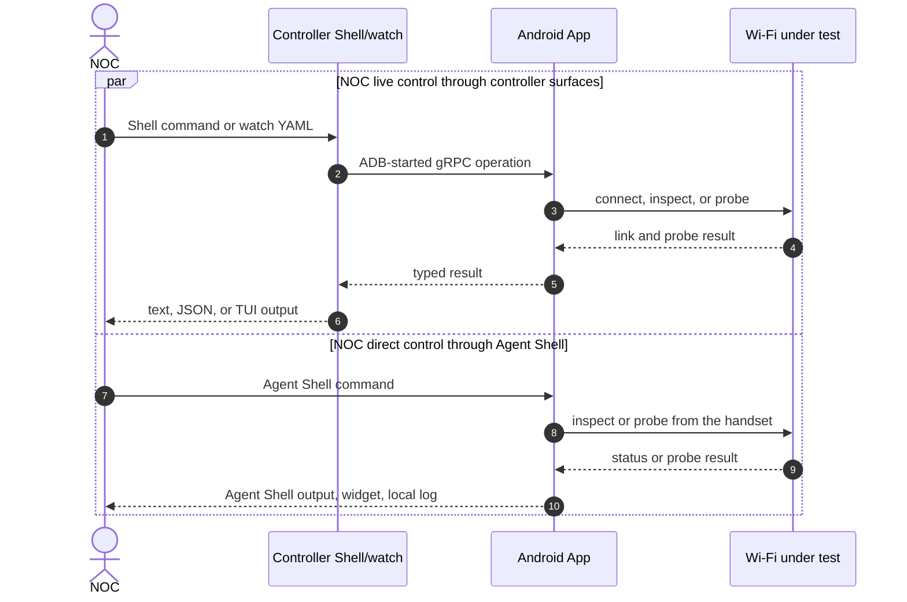

# dropcheck-agent

ADB-controlled Android probes for automated Wi-Fi and access-network end-to-end tests. Born at ShowNet, built for every event NOC.

## Overview

Android handsets act as field probes for event NOCs.
Instead of checking connectivity from the infrastructure side, each check measures from the same user-facing access network that attendees and staff devices use.

The 2.0 operator surfaces are PC Controller Shell, Android Agent Shell, Android widgets, and `dropcheck watch`.
The agent is the on-device probe. A small [Go API](docs/go-api.md) exposes basic typed operations, not a scenario or test DSL.



## Requirements

Android agentのビルドにはJDK 17、Android SDK Platform 37.2、SDK Build Tools 37.0.0を使用します。
AGP 9.5.0のbuilt-in KotlinとGradle 9.8.2を使用し、compile SDK 37.2 / target SDK 37へ移行しました。[SDK移行記録](docs/android-17-migration.md)に互換性・LAN権限・検証範囲を記載しています。Android 17以降のLAN通信には`ACCESS_LOCAL_NETWORK`の許可が必要です。権限はアプリ画面から要求し、拒否時に自動許可や別Networkへの迂回は行いません。

For the Android agent, use an Android 12+ test device with USB debugging enabled. The debug APK is installed over ADB:

```console
$ make install SERIAL=35251JEHN00258
```

Wi-Fi provisioning uses Android privileged Wi-Fi APIs. For Shell `request wifi connect`, `disconnect`, `cycle`, and `forget`, make the app a device owner on a fresh, unmanaged test device.

> [!WARNING]
> Device Owner mode is for dedicated test handsets. Do not enable it on a personal daily-driver device. Android can prevent removing a Device Owner unless the APK is `android:testOnly`; the debug APK installed by `make install` is test-only, but a release or manually modified APK may require a factory reset to remove once it owns the device.

Uninstalling the agent can also remove Wi-Fi profiles provisioned by that app. A
signature-mismatched replacement may therefore lose saved networks even when no
factory reset is performed; use the original signing key for an in-place update
when those profiles must be preserved.

Before setting Device Owner, the device must have no existing Device Owner or Profile Owner, no secondary users, and no local accounts. Removing a Google account from the web is not enough; remove every account from **Settings > Passwords & accounts** on the device, then verify:

```console
$ adb -s 35251JEHN00258 shell dpm list-owners
$ adb -s 35251JEHN00258 shell pm list users
$ adb -s 35251JEHN00258 shell dumpsys account | grep -E 'Accounts:|Account \{'
```

If `dumpsys account` still shows accounts, remove them from device Settings. If Device Owner setup still fails with an already set-up/provisioned-device error, use a freshly factory-reset test device, or reset a test device with Android's test harness mode:

```console
$ adb -s 35251JEHN00258 shell cmd testharness enable
```

`cmd testharness enable` performs a factory reset. After the reset, skip account sign-in during setup, enable USB debugging, install the agent, and set Device Owner:

```console
$ make install SERIAL=35251JEHN00258
$ adb -s 35251JEHN00258 shell dpm set-device-owner io.dropcheck.agent/.DeviceAdminReceiver
$ adb -s 35251JEHN00258 shell dpm list-owners
```

Newly provisioned devices should use `io.dropcheck.agent/.DeviceAdminReceiver`.
Some existing test handsets may still report the legacy component `io.dropcheck.agent/.DropDeviceAdminReceiver`; keep using the component shown by `dpm list-owners` for teardown on those devices.

For debug APKs installed by `make install`, Device Owner can usually be removed during test teardown with:

```console
$ adb -s 35251JEHN00258 shell dpm list-owners
$ adb -s 35251JEHN00258 shell dpm remove-active-admin <component-from-list-owners>
```

Grant Wi-Fi visibility permissions, or open the app once and approve the prompts:

```console
$ adb -s 35251JEHN00258 shell pm grant io.dropcheck.agent android.permission.ACCESS_FINE_LOCATION
$ adb -s 35251JEHN00258 shell pm grant io.dropcheck.agent android.permission.ACCESS_BACKGROUND_LOCATION
$ adb -s 35251JEHN00258 shell pm grant io.dropcheck.agent android.permission.NEARBY_WIFI_DEVICES
```

Keep Location enabled on the device; Android hides SSID, BSSID, scan, and MLO details without it.

### Controller service caller boundary

`AgentService` remains exported for `adb shell am start-foreground-service`, but Android checks
`android.permission.DUMP` on the original caller **before** delivering a start intent, even when
the service is already running. The platform shell holds this permission; Android also allows
the component's own UID, so clock-widget start/stop needs no extra grant. The agent does not
request DUMP. Ordinary installed apps cannot obtain it through a runtime permission prompt.
Platform/privileged apps and apps explicitly granted this development permission by an ADB
operator are trusted callers too; do not grant DUMP to untrusted apps. Device Owner alone is
not the service-start authorization, and the gRPC token does not replace this caller boundary.

This uses the platform's [DUMP declaration](https://android.googlesource.com/platform/frameworks/base/+/android-16.0.0_r1/core/res/AndroidManifest.xml)
(`signature|privileged|development`), [shell grant](https://android.googlesource.com/platform/frameworks/base/+/android-12.0.0_r1/packages/Shell/AndroidManifest.xml),
and [component UID/permission check](https://android.googlesource.com/platform/frameworks/base/+/android-12.0.0_r1/core/java/android/app/ActivityManager.java).
No caller UID is inferred from `onStartCommand`, which is dispatched by the system.

Device checks are still required on dedicated API 31/32 and current supported handsets.
Build the minimal native instrumentation APK with `./gradlew :agent:assembleDebugAndroidTest`.
After installing both debug APKs, run these **device-only** checks:

```sh
adb shell am start -W -n io.dropcheck.agent.test/io.dropcheck.agent.UntrustedServiceCallerActivity
adb shell run-as io.dropcheck.agent.test cat files/service-caller-result
adb shell am instrument -w io.dropcheck.agent.test/io.dropcheck.agent.ServiceSameUidInstrumentation
```

The test activity runs in its own test package (a separate UID with no DUMP grant) and requires
permission-specific denial for controller and widget intents. It uses only Android/Java APIs;
the standalone test APK cannot rely on the target APK's Kotlin runtime. The verdict records
each action's `SecurityException` and `android.permission.DUMP`, not just a PASS marker.
Run it once with the service
stopped and again while a normal controller session is active; the latter session must retain
its connection and continue a harmless status command, with no superseded-session event.
The native instrumentation targets the agent UID and exercises widget observer start/stop only.
Run instrumentation separately from the active-session denial check: Android can restart the
instrumented app. The standalone denial activity does not instrument or restart the agent.
Separately run the normal controller `show wifi status` ADB flow twice to verify authorized
start and session replacement. FGS lifecycle/permissions and actual widget updates must also
remain healthy; a background-start restriction alone is not evidence of caller authorization.

### Wi-Fi Network identity

Per-Network status, SSID selectors, widgets, and event logs use WifiInfo associated with that
exact Android `Network`. On-demand capabilities redact location-sensitive identity on API 31+;
when necessary, a location-inclusive network callback obtains the associated snapshot with a
one-second bound and unregisters after each lookup. It never assigns global
`WifiManager.connectionInfo` to another Network or keeps an inferred identity cache.
This follows the platform's [on-demand redaction and callback contract](https://android.googlesource.com/platform/packages/modules/Connectivity/+/refs/heads/android12-release/framework/src/android/net/ConnectivityManager.java).
The existing Location/visibility grants remain required. Missing/redacted identity is logged
as `wifi.identity.unavailable`; that candidate is explicitly rejected, while selection continues
to any known matching Network. If no match can be selected and a candidate's identity is unknown,
the specific SSID selector fails with an identity-unavailable error rather than guessing.
A blank selector needs no SSID identity. VPNs may report their underlying Wi-Fi transport but are not physical Wi-Fi
candidates; their IP status must not inherit the underlying network's WifiInfo.

## Features

The controller/agent toolchain shares typed agent operations across Shell, widgets and watch.
Use Controller Shell for field work, Agent Shell for direct handset inspection, and `dropcheck watch` for continuous YAML-driven monitoring with a dashboard, plain findings or JSONL events. The former one-shot CLI, separate `tui` workflow and Go test DSL have been removed; no compatibility aliases are provided.

### Controller Shell

The controller starts an ADB-backed authenticated gRPC session to selected Android agents.
Place transport flags (`--adb`, `--serial`, `--package`, `--listen`) before `shell` or `watch`. Shell supports a startup `--target`; targets remain pinned to their resolved identities. `show devices` inside Shell lists connected agents, not an independent ADB inventory command.
Shell provides prompts, completion, context help and safe output filters. Use `show` for inspection, `debug` for explicit raw evidence, `request` for scans/probes/mutations, `test` for finite evaluations, and `monitor` for finite sampling. See [the current Shell hierarchy](docs/shell-2.0/commands.md).
For PC `request wifi connect`, `passphrase-env LAB_WIFI_PSK` reads an already-set environment variable instead of entering the credential itself. It must be nonempty and valid; conflicting or invalid explicit sources fail without fallback. Session defaults are memory-only and do not survive Shell exit.

The controller builds one host-side binary:

```console
$ make build TARGET=controller
+ mkdir -p dist
+ go build -ldflags -X\ github.com/mi2428/dropcheck-agent/controller/internal/version.Version=0.9.0-dirty -o dist/dropcheck ./cmd/dropcheck
```

Inside Shell:

- **Wi-Fi and IP inspection:** `show wifi status [full|connection|ip|capabilities|eht]`, `show wifi scan`, and `show network [default|id ID]`.
- **Wi-Fi control:** `request wifi connect|disconnect|forget|reconnect|cycle`, `test wifi`, and `monitor wifi`.
  Android cycle cleanup is attempted even on interruption; failed disconnect or
  partial network removal is not a successful cycle. HTTP probe connections
  are closed on success, error, and interruption.
- **Network probes from the handset:** `request ping`, `request traceroute`, `request pmtu`, `request ip external`, `request dns resolve`, `request http check`, and `request http download`.

Common examples:

```console
$ controller/dist/dropcheck --serial R5CT12345 shell
$ printf '%s\n' 'show wifi status | display json' 'exit' | controller/dist/dropcheck --serial R5CT12345 shell
```

`show wifi status` is a quick Android observation with no PC ADB supplement. Full/IP/EHT views retain separately labelled host diagnostics, including IPv6 RA settings/default routes and decoded lifetimes where available. Explicit `debug adb` requests only the fixed allowlisted sources under a bounded collection deadline; it is not an arbitrary ADB shell.

A short interactive session (measurement output depends on the connected handset):

```console
$ controller/dist/dropcheck --serial R5CT12345 shell
dropcheck: selected agent=R5CT12345
press '?' for Controller Shell context help, or type 'help' for commands
R5CT12345> show wifi ?
  status
  scan
R5CT12345> show wifi status
R5CT12345> show wifi status ip
R5CT12345> request ping 192.0.2.1 count 3
R5CT12345> exit
```

Scalar options use `key value`; `brief` and `mlo` are scan switches. `request wifi scan [eht]` requests a bounded fresh scan; `show wifi scan` reads the cache. `require-ip`, `require-validated`, and `forget-after-each` require explicit booleans. `request traceroute via ADDRESS` may repeat and is checked against typed hops, not stdout. Probe family `auto` selects one family; `request ip external family all` checks both, and `request dns resolve NAME record ALL` requests A+AAAA. Explicit numeric values are bounded per operation; traceroute accepts at most 255 hops. Wi-Fi passphrases must be 8–63 UTF-8 bytes or 64 hexadecimal digits. Quoting preserves literal SSIDs, hostnames and URLs, including keyword-like names and pipes.

Both Shells support `show network`, `show network default`, `show network id ID`, `show permissions`, no-Enter `?`, completion and session-only in-memory command recall. Output stages `find`, `match`, `except`, `last`, `trim` and `count` operate on safe logical lines before width layout. Exclusive `| display json` emits an `ok`/`lines` presentation envelope. `begin`, `display set` and `no-more` are rejected. Recall may contain submitted credentials; transcript/output redaction is a separate boundary. See [the Shell command contract](docs/shell-2.0/commands.md) for limits and maintenance.

Network-bound status and probes can select `ssid`, `bssid` and canonical decimal `network-id`. YAML observed targets accept `bssid` and `network_id` with the same selection-time meaning. Missing, redacted or changed requested identity never falls back to another Network. This is **not** an uninterrupted association, roam or VPN-coexistence guarantee. Transport heartbeat, pending commands and cleanup errors remain distinct from Wi-Fi outcomes.

#### Named checks: observed and configured active

`test link ssid "Example Lab" [family ipv4|ipv6|all]` inspects an **existing** physical Wi-Fi Network. Omitting family means IPv4; `all` checks both families using the same two observations on PC and Android. Both must report the same Network/interface, the requested case-sensitive SSID, and an address, default route and DNS server for each requested family. Android's `validated` flag is observation only, not a passed internet probe. `link` never connects, disconnects, forgets a network or contacts an external endpoint. A requested `bssid` is still rejected for this profile: selection-time BSSID matching does not establish uninterrupted Network pinning. A detected wrong/unknown Network is MISSING, not a pass. This does **not** prove that no transient roam occurred between observations.

Configured `lab` is available on PC and Android Shell with the same operation order: `test lab ssid "Example Lab" family ipv4 gateway 192.0.2.1 dns lab.example.test resolver selected http https://lab.example.test/health expected-status 204 timeout 5000`. Supply **your own approved endpoints**; no defaults or public fallback exist. An existing physical Wi-Fi is observed before and after three gateway ICMP packets, one A (or AAAA for ipv6) query through the selected Network's configured resolver, and one HTTP request. Failed required stages stop later probes. The URL must have no userinfo, query or fragment; redirects are disabled. No Wi-Fi configuration is changed. HTTP hostname address family and uninterrupted roaming are **not** pinned or proven.

`request wifi connect SSID` can use a session default set by `set cli default-passphrase SECRET` and cleared by `clear cli default-passphrase`. Bare `test` displays local help without executing; `show test profiles` lists profiles and costs, and `show test last` reads the historical session report without rerunning or granting current readiness. Unconfigured `lab`, unsupported `internet`/`eht`, and strict BSSID pinning do not fall back to a public service or run a partial test.

### Android Agent and Agent Shell

Install the Android agent on a test handset:

```console
$ make install SERIAL=R5CT12345
+ ./gradlew :agent:assembleDebug -PdropcheckVersion=0.9.0-dirty
+ adb -s R5CT12345 install -r -t agent/build/outputs/apk/debug/agent-debug.apk
```

The Android agent executes controller requests, records structured local logs, renders widgets, and hosts Agent Shell for direct handset-side inspection.
Agent Shell accepts the same portable hierarchy and pipelines as Controller Shell, excluding PC-only device/ADB/exit commands; its target is always self. Unsupported profiles never start an operation.
For handset-side joins, `set cli default-passphrase SECRET` retains a default only in session memory for `request wifi connect SSID`; an explicit passphrase overrides it. The default is not persisted to preferences or saved Activity state. Submitted input remains in session-local recall, including credentials.
Wrap SSIDs or PSKs in double quotes when they contain spaces or other shell-significant characters.

#### Result presentation and safe copy

- Acquisition `OK` is not a scenario `PASS`. Failed/canceled acquisition and its reason precede reference data; source, selected target, requested fresh, actual scan update, acquisition duration, and observation age are separate facts. Scan age is supplied by Android's monotonic collector, never calculated from a PC wall clock and a device boot timestamp.
- Wi-Fi status is the L2 view; IP status retains addresses/prefixes, routes/zones, DNS, DHCP, MTU, private DNS, NAT64, and the selected versus Android-default Network. Device capabilities use supported/unsupported lists, not the connected AP. Missing observation metadata is `?`, known empty data is `none`, inapplicable is `n/a`, and an observed false value is `no`.
- TTY text uses the terminal column budget. Unknown-width/pipe text keeps complete records; typed Go results remain independent of width. Scan layouts use complete AP tables when they fit, brief SSID groups where possible, and complete records otherwise. AP indices link supplemental evidence without truncating network identities. Security sets such as `psk+sae` and unknown enum spellings remain intact. Named status subjects and `full` expose detailed safe evidence; the removed `detail` suffix is not an alias.
- Agent Shell uses the laid-out content width and the output TextView's Paint, native grapheme boundaries and tab-stop spans. Width zero waits for layout. Rotation, split-screen, IME/inset changes and font-scale reflow retained presentation data without another scan/probe.
- **Output size** selects base/minimum sizes for new blocks. The existing 10sp base is unchanged; 12sp is a selectable candidate, not a device-approved default. Input and unrelated older blocks do not shrink to fit a table. Structural layouts currently require no automatic shrink; any later block-only shrink must stay within 10% and above 10sp/the chosen minimum, preserving system font scale.
- **Copy full result** copies plain sanitized values, not spans, display tabs, ellipsis, ANSI, artificial zero-width spaces, or credentials. History retains at most 32 whole safe blocks and 262144 UTF-16 characters, without commands/credentials. Table display is capped at 96 rows/240 lines, with omission counts; full copy keeps retained rows. A result exceeding in-memory history keeps its header/target/errors plus **Inspect/copy full safe values**: 25-label pages expose each complete safe value, with exact full identity copy and numbered chunks for long opaque values that cannot fit a clipboard transaction. Only the current oversize result has a private app-cache value file (32MiB quota); replacing it evicts the old file/block as a unit, and a new process clears abandoned files. Storage/quota failures are explicit, never silently clipped results. Appends do not force an older reader to the bottom. Native selection/anchor restoration is best effort.
- Host ADB supplements carry a separate `adb` source and controller receipt time; those are not Android observations. Native Paint, clipboard, accessibility/TalkBack and readability acceptance require separately authorized device checks; JVM formatter tests or an APK build are not device evidence.

Drive the agent from the controller for live measurements (synthetic addresses and targets shown as commands, not measured output):

```console
$ controller/dist/dropcheck --serial R5CT12345 shell
R5CT12345> show devices
R5CT12345> request wifi scan band all timeout 9000
R5CT12345> request ping 192.0.2.1 count 1
```

Ping packet counts, loss, and RTT come from typed Agent observations. Missing
native statistics remain unknown (not zero), including in JSON, Go results/YAML
expectations, and text; native output is reference only.
Shell `| display json` emits sanitized presentation lines with a typed `ok` value; it is not a protobuf dump. The basic Go API returns typed acquisition data, not sanitized presentation; callers must protect raw payloads before logging. An operator may
explicitly run `request http check URL expected-status CODE ssid SSID` and
`request dns resolve NAME record ALL ssid SSID` on an existing connection; these send active
Internet traffic and do not turn an unmanaged public endpoint into a lab profile.

### Android widgets

The Android clock/network and log widgets display on-device observations and local diagnostics. Widget observer start/stop uses the app's own UID; it does not bypass the service caller or Wi-Fi permission boundaries described above.

### Continuous watch dashboard

`dropcheck watch -c PLAN.yml` is the immediate continuous-run entry. The dashboard consumes private `internal/watchrun` events; there is no separate plan-selection/review/rerun application or public scenario API. Dashboard metadata and bounded histories remain available, along with pause/skip controls and cancellation-safe owned-connection cleanup. JSONL records ordered events independently of the dashboard. `--no-tui` prints findings without opening a terminal UI.
It is meant for field operation: connection failures and failed `required: true` checks skip the remaining checks for that target, other check failures are recorded as findings, and the next target and round continue.
Use `--jsonl` when you also want an append-only event log.
When multiple agents are connected, unassigned targets run on every selected agent.
Omitting `--target` selects all connected agents; unlike Shell, watch does not
require an explicit broadcast choice. A target that needs profile removal or MAC
rotation requires every bound agent to advertise `wifi.forget.typed`, checked
before any Wi-Fi operation. Cleanup and rotation always use the literal SSID,
never an ambiguous numeric configuration target.
Set `agent:` on a target to bind it to one Android agent by ADB serial; a unique serial prefix is accepted, while device model names are display-only in the YAML plan.
For an existing connection, set `observe: true` on a target and use only
`wifi_status` or `ip_status` checks. Observed targets never connect, disconnect,
forget, or send active probes; connection and cleanup options are rejected before
execution. This does not prove that no roam occurred between observations.
To **explicitly** authorize traffic on that existing connection, also set
`active_probes: true` and supply every probe host, DNS name or URL. Missing
destinations and the fixed global-IP endpoint are rejected; Wi-Fi configuration
still cannot be changed. Unlike configured `lab`, generic active YAML does not
implicitly add the two Network identity snapshots.

```console
$ controller/dist/dropcheck --serial R5CT12345 watch -c examples/watch.yml --jsonl watch.jsonl
$ controller/dist/dropcheck --serial R5CT12345 watch -c examples/watch.yml --no-tui --jsonl watch.jsonl
```

```yaml
version: 1
name: shownet-watch
round_interval: 0s

defaults:
  passphrase_env: DROPCHECK_WIFI_PSK
  security: wpa3
  # Use non-persistent plus mac_rotation when each target or round should get a
  # fresh randomized MAC. Supported rotations are none, per_target, and per_round.
  mac_randomization: non-persistent
  mac_rotation: per_target
  require_ip: true
  require_validated: true
  disconnect_after: true
  forget_after: true

targets:
  - name: noc-6g-ap1
    # Optional: bind this target to one connected agent by ADB serial.
    # A unique serial prefix is accepted; device model names are display-only.
    # agent: R5CT12345
    ssid: ShowNet
    bssid: aa:bb:cc:dd:ee:ff
    band: 6ghz

checks:
  - name: wifi link
    type: wifi_status
    expect:
      ssid: ShowNet
      band: 6ghz
  - name: ip
    type: ip_status
    required: true
    timeout: 45s
    expect:
      validated: true
      default_route: true
      ipv4_default_route: true
      dns_server_count: ">=1"
      mtu: ">=1280"
      ipv4_addresses:
        cidr: 192.168.20.0/22
      ipv4_dns_servers:
        cidr: 192.168.20.0/22
        mode: at_least
  - name: ping cloudflare
    type: ping
    host: one.one.one.one
    family: ipv4
    count: 5
    expect:
      received: 5
      loss_percent: 0
  - name: dns cloudflare
    type: dns
    query: one.one.one.one
    record: A
    expect:
      a_answers:
        exact:
          - 1.0.0.1
          - 1.1.1.1
```

For `ping`, `traceroute`, and `path_mtu`, `family: ipv4` or `family: ipv6` pins a dual-stack hostname probe to one address family.
Leave `family` unset when the agent should auto-select based on DNS answers and usable source addresses.

### Removed archive and observability support

Historical standalone archive ingestion/replay and the external MinIO,
Pushgateway, Prometheus, Grafana, and Compose stack are no longer supported.
Use Shell or watch for live measurements; local
diagnostic logs, JSONL output, and in-memory TUI history remain available.

Update the controller and Android APK together; mixed-version compatibility and
archive decoding are not provided. Existing user `.pb` archives, saved Compose
volumes, old preferences, and Device Owner state are not automatically deleted
or migrated. Back up any data you need before manually retiring an old deployment.
Agent Shell no longer reads or writes a persisted default PSK. The retired
`default_passphrase` key in `agent-shell-use-defaults` is removed when the Activity
or agent service starts. Enter a session default again with
`set cli default-passphrase SECRET` or use `request wifi connect SSID passphrase SECRET` explicitly.
Other old preferences are left intact; do not include PSKs in migration reports or logs.

### Basic Go API

Use `github.com/mi2428/dropcheck-agent/controller/pkg/dropcheck` for an ADB-backed client and individual typed operations. The public surface owns session startup/close, agent enumeration and `Client.Run`; internal command/control/session/runner/protocol packages are not public imports. See [the Go API guide](docs/go-api.md). Scenario Plans, test adapters, fluent assertions and the private watch runtime are not a supported Go API.

For a local checkout, use `replace github.com/mi2428/dropcheck-agent/controller => /absolute/path/to/dropcheck-agent/controller` in the consumer module. Versioned consumption without a replacement is possible once a corresponding `controller/vX.Y.Z` release tag has actually been published; select an available version then. This change does not publish a tag or module version. The offline distribution check validates replacement-free consumption with a synthetic version in a local file proxy, not a remote release.

Watch YAML keeps retry/repeat/eventually/stability policies and flat metric/AP/MLO/CIDR expectations. Attempts includes the first measurement; repeats are independent, and stability permits retry recovery within each sample rather than proving uninterrupted connectivity. Unknown options and invalid plans fail before device dispatch. Reports/events retain attempts, recovery, missing/skip/cancel reasons, and independent primary/cleanup/delivery failures. Owned target cleanup remains bounded disconnect-then-forget, including cancellation. Existing external YAML defaults are not implicit authorization for a lab profile.

## Controller unit tests

Controller unit tests use temporary fake ADB executables, not connected devices.
Ordinary untagged tests also check all 236 rows of
`controller/integration/e2e/testdata/e2e_cases.tsv`: 100 parser/help rows execute
in-process, and 136 Shell rows have their parse expectations checked.
The table's surviving IDs are intentionally non-contiguous. These checks use
deterministic synthetic placeholders, not `loadConfig`, lab credentials, ADB
discovery, or a controller process. Invalid tables, missing command coverage,
empty help, and success/error expectation mismatches fail the ordinary suite.
`make test TARGET=controller` uses `-count=1` for fresh test execution.
Fake-process success checks include OS scheduling, shell startup, and, for session
tests, multiple process launches plus the local gRPC handshake. On shared or busy
hosts, run only one controller test invocation at a time and run its Go packages
serially so competing package builds/tests do not consume those budgets:

```console
$ make test TARGET=controller GOFLAGS=-p=1
$ cd controller
$ go test -p 1 -race -count=1 ./...
$ go test -p 1 -count=1 -v ./integration/e2e
$ go test -p 1 -race -count=10 ./internal/adb ./internal/session ./internal/app
```

`-p 1` limits this invocation's package parallelism; it does not serialize other
test jobs or disable concurrent controller code and the race detector.
Fake-process timeout/cancellation tests still run and report elapsed time, timeout
state, and exit status with `-v`. `TestFakeADBLaunchDiagnostics` separates process
creation from completion for a shell-builtin-only fixture; the cancellation check
waits for an explicit startup marker before canceling and verifies that the child
is reaped. Keep existing success-check deadlines and production ADB timeouts
intact; investigate these diagnostics and competing jobs before extending a
timeout. Leave `DROPCHECK_E2E_LIVE` unset for device-free checks. To verify both
supported Go versions locally, run the controller gates sequentially with
`GOTOOLCHAIN=go1.26.0` and `GOTOOLCHAIN=go1.26.8`, always using `GOFLAGS=-p=1`.

Android bindings, the complete JVM suite, and lint can be checked fresh without a
handset using the configured JDK/SDK:

```sh
./gradlew :agent:assembleDebug :agent:testDebugUnitTest :agent:lintDebug --rerun-tasks --no-build-cache
```

The controller target also runs race-instrumented real-readline PTY history and
cancellation checks without ADB. These fake/parser/JVM/PTY checks do not prove
real Wi-Fi or selected-Network behavior; permissioned live checks require dedicated authorized handsets,
approved networks/credentials, bounded scope, and cleanup/restore precautions.
Record actual execution, skips, and cache usage separately; unavailable device or
PTY evidence remains pending rather than an ordinary CI pass.

## Protobuf binding generation

The shared schema is `proto/dropcheck/v1/control.proto`. Go bindings are committed
under `controller/internal/controlpb`; Android generates its bindings through
Gradle using the versions in `agent/build.gradle.kts`.

For Go generation, install **protoc 35.0** from the
[official release](https://github.com/protocolbuffers/protobuf/releases/tag/v35.0):
download the `protoc-35.0-<platform>.zip` matching your OS and architecture,
verify its SHA-256 against the release asset digest, extract it, and put its `bin`
directory on `PATH` (or set `PROTOC` to the extracted executable).
`protoc --version` must print `libprotoc 35.0`.
Go must meet `controller/go.mod`'s **1.26.0** minimum; CI also tests **1.26.8**.
Separately install `protoc-gen-go` **v1.36.1** and `protoc-gen-go-grpc` **v1.3.0**
before generation. Put their executables on `PATH`, or set `PROTOC_GEN_GO` and
`PROTOC_GEN_GO_GRPC` to their paths, just as `PROTOC` selects protoc.
From a clean committed baseline at the repository root:

```sh
make generate-go
git diff --exit-code -- controller/internal/controlpb
make generate-go
git diff --exit-code -- controller/internal/controlpb
make test TARGET=controller GOFLAGS=-p=1
```

The target resolves all three preinstalled executables to absolute paths and
rejects missing tools or any version mismatch before writing bindings. Generation
itself never installs tools, fetches dependencies, or falls back to other versions.
These generator versions intentionally preserve the existing Go API and are
independent of the newer runtime dependencies. The include root is
`proto/dropcheck/v1`, so the descriptor source stays `control.proto`;
`paths=source_relative` maps both outputs directly into `controlpb`.
Do not hand-edit generated files.

Unchanged-schema generation must produce identical bytes on the second run.
From a clean checkout, a generation-drift check is:

```sh
make generate-go
git diff --exit-code -- controller/internal/controlpb
```

CI provisions the official `protoc-35.0-linux-x86_64.zip` release asset and verifies
SHA-256 `a45cda0989c17dd950db55f6fbe1e5814c50fda08e87aa422980ac1f89dddbbc`
before extracting it. CI provisioning must also supply both pinned Go plugins
before invoking generation. The generator target and clean-diff gate reject
binding drift; the second unchanged local generation must also leave no diff.
For schema edits, reserve both removed field numbers and names, preserve enum
numbers and retained wire identities, regenerate Go, and validate both
consumers with `make test TARGET=controller` and
`make build test TARGET=agent`. The Android tasks regenerate through Gradle;
do not use the host Go generator versions to override Android's toolchain.
Go-only watch/runtime maintenance does not require an Android schema change.

## Continuous integration

`.github/workflows/ci.yml` uses `ubuntu-latest-self-hosted` for repository pushes
and authorized manual runs. It does not run pull-request code because the runner
can reach the lab LAN. Actions are pinned to immutable revisions. See
[CI operation and enablement](docs/ci.md); a local pass is not evidence of a remote
job completing.

The controller matrix uses Go **1.26.0 / 1.26.8** and staticcheck v0.7.0. Android
uses Temurin JDK 17, SDK platform 37.2 and Build Tools 37.0.0. Gradle and dependency
versions come from the committed build files.

Each controller matrix entry provisions verified protoc 35.0 and runs
`make generate-go` plus `git diff --exit-code -- controller/internal/controlpb`,
then `make fmt-check`, `make modernize-check`, `make build TARGET=controller`,
`make test TARGET=controller`, `make lint TARGET=controller`, and
`go test -race -count=1 ./...` from `controller/`. Job-wide `GOFLAGS=-p=1`
serializes package work for tool installation, build, tests, vet, staticcheck,
and race checks. `GOTOOLCHAIN=local` prevents an automatic toolchain switch from
hiding a declared-minimum failure. Local controller checks must also run one job
at a time per host with `GOFLAGS=-p=1`.
The formatting gate is read-only and excludes generated
`controller/internal/controlpb` files, matching `make fmt TARGET=controller`;
it does not run the source-rewriting
`make quality` target. Ordinary normal/race suites include the untagged E2E
table/parser/help checks, not skipped live matrix cases. The Android job keeps
the existing build/lint Make targets and runs the complete
`:agent:testDebugUnitTest` task with `--rerun-tasks --no-build-cache` and the SDK
installed. No secrets, connected
handset, or Wi-Fi credentials are needed by either job.

Live `make e2e` Shell device tests are excluded: they require
dedicated authorized handsets and network credentials, never an ordinary CI
runner. Regression tests in the normal controller and Android unit-test suites
run automatically without adding special workflow filters.

Historical device results in [the acceptance record](docs/shell-2.0/acceptance.md)
predate the current Shell cutover and are not acceptance evidence for current
commands. Record new verification against the actual revision and scope instead
of carrying old test counts or retired entry-point results forward.

## License

MIT
